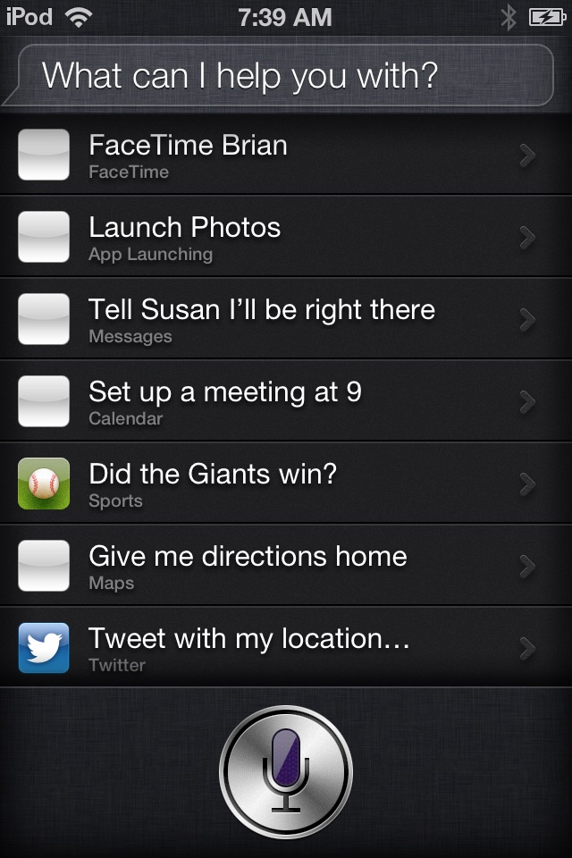
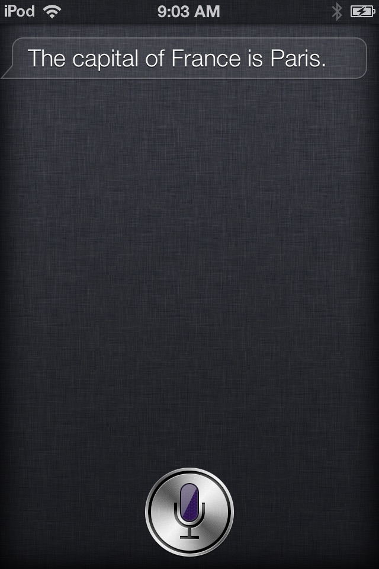

# Local Siri on an iPod touch 4

The iPod touch 4th generation never got Siri: Apple shipped it only on the iPhone 4S. This project brings over the **genuine iOS 6 Siri interface** and answers it **entirely on the iPod**. Speech recognition and the language model run on its single 1 GHz Cortex-A8 core with 256 MB of RAM. There is no cloud, and no computer is needed at run time.

<p align="center">
  
  
  
</p>

**How it works, step by step:** <https://tslmy.github.io/local-siri-on-ipod-touch-4/>

```
Hold Home ─▶ SpringBoard's Siri UI (iPhone 4S files) ─▶ assistantd ──ACE over loopback──▶ acesrv
                                                                                          │ audio
                                                                                          ▼
                                                               localsirid: Moonshine Tiny ─▶ SmolLM2-135M
```

- **Siri itself** is Apple's: the UI, `assistantd` and the rest come from the iPhone 4S iOS 6.1.3 firmware, which you download from Apple yourself. Only one binary, `AssistantUI`, is missing from the iPod's own system, and it has to be pulled out of the 4S's shared library cache and repaired so it loads on another device.
- **`acesrv`** is a small server that speaks Siri's ACE protocol over loopback. It stands in for Apple's servers, which went offline long ago.
- **`localsirid`** runs the two models in plain C with ARM NEON:
  - [Moonshine Tiny](https://huggingface.co/UsefulSensors/moonshine-tiny) (27M parameters, 8-bit) for speech recognition;
  - [SmolLM2-135M-Instruct](https://huggingface.co/HuggingFaceTB/SmolLM2-135M-Instruct) (4-bit layers) for the answer.
- **A tweak** (`SiriCapability`) makes the iPod report the Siri capability. It also switches Siri to recording plain PCM, because the iPod has no Speex encoder, and disables response timeouts that were sized for Apple's servers.

## Status

Tested on an iPod touch 4G (iPod4,1) running iOS 6.1.6 (10B500), jailbroken.

| | |
|---|---|
| Native Siri UI opens, listens, shows what you said, shows and speaks the answer | ✅ Live microphone, with questions spoken by a Mac nearby |
| Speech recognition (Moonshine Tiny) | 1.5–3.5 s for a short question |
| Answer, first word | 2–7 s after the transcript. The model pages in from flash, because the Siri UI leaves little RAM free. |
| Answer, generation | 2–4 words/s |
| Total, from when Siri stops listening to the full answer | about 10–20 s |
| Answer quality | What a 135M model can do: simple facts are usually right ("Paris", "Tokyo"), other answers are often vague or wrong |
| Physical Home-button hold | Should behave like Activator's Siri action, which is what was tested; not pressed by hand yet |

## What you need

**The iPod**
- An iPod touch 4G on iOS 6.1.6, jailbroken (for example with p0sixspwn).
- OpenSSH, with your public key in `/var/root/.ssh/authorized_keys`.
- Cydia Substrate.
- About 180 MB free on `/` and 130 MB in `/var`.
- Optional: Activator. `just ask` uses it to open Siri remotely.

**The Mac**
- macOS with Rosetta 2. The Xcode 4.6 compiler is an Intel binary.
- [Homebrew](https://brew.sh): `brew install just uv ldid boost`.
- **Xcode 4.6.3** (`xcode4630916281a.dmg`) from [Apple's developer downloads](https://developer.apple.com/download/all/?q=xcode%204.6.3), which needs a free Apple ID. It's the newest toolchain that still targets armv7 and iOS 6.
- About 4 GB of disk, and internet access for the firmware (925 MB from Apple) and the models (from Hugging Face).

`just doctor` checks all of this. With `IPOD` set, it checks the iPod too.

## Two commands

```sh
just setup ~/Downloads/xcode4630916281a.dmg     # toolchain, 4S firmware, AssistantUI, models, build
IPOD=root@192.168.1.23 just install             # copy to the iPod and respring
```

Wait about 20 s for the models to load, then hold the Home button and ask something. Then try:

```sh
IPOD=root@192.168.1.23 just smoke "How far away is the moon?"   # the on-device brain alone
IPOD=root@192.168.1.23 just ask "What is the capital of Japan?" # through the Siri UI; the Mac speaks
```

Use `IPOD_KEY=~/.ssh/some_key` if your login needs a particular key. You can also put both variables in a `.env` file.

| Recipe | What it does |
|---|---|
| `just toolchain <dmg>` | Copies Xcode 4.6.3's armv7 clang and the iOS 6.1 SDK into `.toolchain/` |
| `just firmware` | Downloads only the root filesystem from the iPhone 4S iOS 6.1.3 IPSW, decrypts it with its published key, and mounts it read-only |
| `just assistantui` | Builds kennytm's `dyld_decache` (pinned and patched), extracts AssistantUI, and repairs it with `port/fixdylib.py` |
| `just models` | Downloads and converts both models (pinned Hugging Face revisions) |
| `just build` | Cross-compiles everything that runs on the iPod into `build/ipod/` |
| `just install` / `just uninstall` | Installs or updates over SSH (safe to repeat); uninstall removes everything and restores the backups |
| `just smoke`, `just ask`, `just logs`, `just screenshot` | Testing |
| `just debug-on` / `debug-off` | A SpringBoard debug tweak, plus assistantd's own log in `/tmp/assistantd.log` |
| `just install-app` | Also installs LocalSiri.app, a stand-alone Siri look-alike that uses the same on-device brain |

## What `install` changes on the iPod

- **Adds** Siri's files from the 4S firmware:
  - `AssistantServices.framework` (assistantd)
  - `AssistantUI.framework`
  - `SAObjects.framework`
  - SpringBoard's `Assistant.uibundle`
  - `/System/Library/Assistant`
  - Siri's settings bundle and its LaunchDaemons.
- **Adds** this project's files:
  - `/var/root/siri/` (localsirid, the models, logs)
  - `/var/root/siri/ace/` (acesrv)
  - two LaunchDaemons, `com.lmy.localsirid` and `com.lmy.acesrv`
  - the `SiriCapability` Substrate tweak.
- **Edits**, each backed up once as `*.bak-localsiri`:
  - Siri's preferences: enabled, `Server Override` set to `http://guzzoni.apple.com:4443`, authentication disabled.
  - SpringBoard's `SBAssistantCapabilityOverride`.
  - `/etc/hosts`.

`/etc/hosts` gains the line `127.0.0.1 guzzoni.apple.com`. Siri only accepts a server override whose host ends in `apple.com`, and it falls back to Apple's real server otherwise. With this line, both its override and its fallback land on the iPod itself, so nothing you say leaves the device.

## Legal

This repository contains only original code and scripts (MIT licensed). **It contains nothing from Apple**:
- Firmware, frameworks and the decached AssistantUI are produced on your machine from files you download from Apple yourself.
- They stay in `build/`, which git ignores.
- Please don't redistribute them.

Third-party code is fetched at build time and isn't vendored:
- Speex 1.2.1 (BSD).
- [kennytm's `dyld_decache`](https://github.com/kennytm/Miscellaneous) (GPLv3), which is only run on your Mac.

The models are downloaded from Hugging Face under their own licences: MIT for Moonshine, Apache-2.0 for SmolLM2.

## Layout

```
src/localsirid/  on-device speech recognition + LLM daemon, and sirictl (test client)
src/moonshine/   Moonshine Tiny in C + NEON
src/llm/         Llama-style LLM runner (GQA, RMSNorm, SwiGLU, KV cache, byte-level BPE)
src/common/      int8/int4 NEON matmul and math kernels
src/acesrv/      ACE server (Siri's protocol)
src/tweak/       SiriCapability Substrate tweak
src/tools/       plistset, screenshot, asllog (the iPod has no syslog), memstat, psrss
src/debug/       SiriDebug SpringBoard tweak + sirinotify
src/app/         LocalSiri.app (stand-alone fallback)
port/            vfdecrypt.py, fixdylib.py, shared-cache inspectors, list of Siri files
convert/         model converters
scripts/         what the justfile runs
docs/            the GitHub Pages article
```

## Credits

- Speech recognition: [Moonshine](https://github.com/usefulsensors/moonshine) by Useful Sensors.
- Language model: [SmolLM2](https://huggingface.co/HuggingFaceTB/SmolLM2-135M-Instruct) by Hugging Face.
- ACE protocol: [SiriServerCore](https://github.com/janrueth/SiriServerCore) and the SiriProxy community.
- Shared-cache extraction: [kennytm's dyld_decache](https://github.com/kennytm/Miscellaneous).
- Firmware keys: [The Apple Wiki](https://theapplewiki.com).
