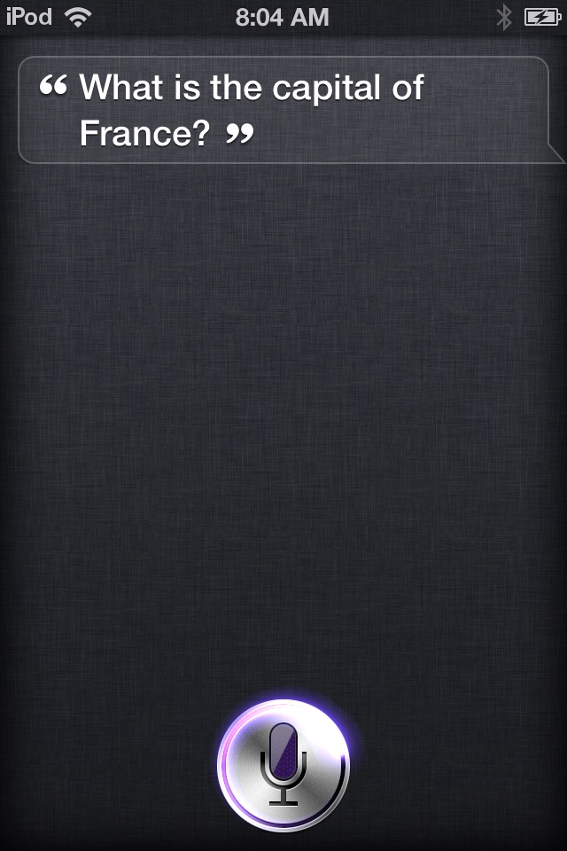

# Local Siri on an iPod touch 4

The iPod touch 4th generation never got Siri: Apple shipped it only on the iPhone 4S. This project brings over the **genuine iOS 6 Siri interface** and answers it **entirely on the iPod**. Speech recognition and the language model run on its single 1 GHz Cortex-A8 core with 256 MB of RAM. There is no cloud, and no computer is needed at run time.

<p align="center">
  
  
  
</p>

**How it works, step by step:** <https://tslmy.github.io/local-siri-on-ipod-touch-4/>

```
Hold Home ─▶ SpringBoard's Siri UI (iPhone 4S files) ─▶ assistantd ──ACE over loopback──▶ acesrv
                                                                                          │ audio
                                                                                          ▼
                                                                    localsirid: Whistle ─▶ SmolLM2-135M
```

- **Siri itself** is Apple's: the UI, `assistantd` and the rest come from the iPhone 4S iOS 6.1.3 firmware, which you download from Apple yourself. Only one binary, `AssistantUI`, is missing from the iPod's own system, and it has to be pulled out of the 4S's shared library cache and repaired so it loads on another device.
- **`acesrv`** is a small server that speaks Siri's ACE protocol over loopback. It stands in for Apple's servers, which went offline long ago.
- **`localsirid`** runs the two models in plain C with ARM NEON:
  - [Whistle](https://huggingface.co/Cactus-Compute/whistle) by Cactus Compute for speech recognition. The published 16.9 MB file runs as is; its 2- and 4-bit weights never get unpacked.
  - [SmolLM2-135M-Instruct](https://huggingface.co/HuggingFaceTB/SmolLM2-135M-Instruct) for the answer, stored in the same 4-bit codebook format as Whistle (76 MB). Each weight's rounding is chosen GPTQ-style.
  - [Moonshine Tiny](https://huggingface.co/UsefulSensors/moonshine-tiny) is still supported as a fallback (`LEGACY_MODELS=1 just models`).
- **A tweak** (`SiriCapability`) makes the iPod report the Siri capability. It also switches Siri to recording plain PCM, because the iPod has no Speex encoder, and disables response timeouts that were sized for Apple's servers. And it replaces Siri's end-of-speech detection: the iPod's microphone is about 15 dB quieter in Siri's recording mode than normal, which made Siri stop listening before you'd spoken.

## Status

Tested on an iPod touch 4G (iPod4,1) running iOS 6.1.6 (10B500), jailbroken.

| | |
|---|---|
| Native Siri UI opens, listens, shows what you said, shows and speaks the answer | ✅ Live microphone, with questions spoken by a Mac nearby |
| Speech recognition (Whistle) | 2.7–3.8 s for a short question with the Siri UI open; 1.3–2.4 s alone (`just bench`) |
| Answer, first word | About 6 s after the transcript: 2.7–3.0 s to read the model back from flash (the Siri UI leaves too little RAM to keep it between questions), then 2.8–3.6 s to read the question. The model is locked in RAM until the answer is done, which removed 1,300–3,500 page faults per question |
| Answer, generation | About 2.5 tokens/s with the Siri UI open (Siri's animation takes ~17% of the CPU); 3.8 tokens/s alone |
| Total, from when Siri stops listening to the full answer | about 12–15 s for a one-sentence answer |
| Answer quality | What a 135M model can do: in live tests "Paris", "Tokyo", "Shakespeare", "Everest" and the Moon's distance were right; "ounces in a pound" still isn't |
| Quiet voices | The iPod's only microphone is on the back, beside the rear camera, and Siri's recording mode is quiet. A voice aimed at the screen reaches it at only 5–10x the room noise. In one round of six real-voice questions, Whistle got 2 right (Moonshine none); the Mac's louder voice is right most of the time. Tilting the top edge toward your mouth helps. If nothing is heard, Siri says "Sorry, I didn't catch that." |
| Physical Home-button hold | Should behave like Activator's Siri action, which is what was tested; not pressed by hand yet |

## What you need

**The iPod**
- An iPod touch 4G on iOS 6.1.6, jailbroken (for example with p0sixspwn).
- OpenSSH, with your public key in `/var/root/.ssh/authorized_keys`.
- Cydia Substrate.
- About 180 MB free on `/` and 100 MB in `/var`.
- Optional: Activator. `just ask` uses it to open Siri remotely.

**The Mac**
- macOS with Rosetta 2. The Xcode 4.6 compiler is an Intel binary.
- [Homebrew](https://brew.sh): `brew install just uv ldid boost`.
- **Xcode 4.6.3** (`xcode4630916281a.dmg`) from [Apple's developer downloads](https://developer.apple.com/download/all/?q=xcode%204.6.3), which needs a free Apple ID. It's the newest toolchain that still targets armv7 and iOS 6.
- About 4 GB of disk, and internet access for the firmware (925 MB from Apple) and the models (from Hugging Face).
- `just models` converts the chat model with PyTorch and needs about 2 GB of RAM for a minute or two.

`just doctor` checks all of this. With `IPOD` set, it checks the iPod too.

## Two commands

```sh
just setup ~/Downloads/xcode4630916281a.dmg     # toolchain, 4S firmware, AssistantUI, models, build
IPOD=root@192.168.1.23 just install             # copy to the iPod and respring
```

Wait about 20 s for the models to load, then hold the Home button and ask something. Then try:

```sh
IPOD=root@192.168.1.23 just smoke "How far away is the moon?"   # the on-device brain alone
IPOD=root@192.168.1.23 just ask "What is the capital of Japan?" # through the Siri UI; the Mac speaks
```

Use `IPOD_KEY=~/.ssh/some_key` if your login needs a particular key. You can also put both variables in a `.env` file.

| Recipe | What it does |
|---|---|
| `just toolchain <dmg>` | Copies Xcode 4.6.3's armv7 clang and the iOS 6.1 SDK into `.toolchain/` |
| `just firmware` | Downloads only the root filesystem from the iPhone 4S iOS 6.1.3 IPSW, decrypts it with its published key, and mounts it read-only |
| `just assistantui` | Builds kennytm's `dyld_decache` (pinned and patched), extracts AssistantUI, and repairs it with `port/fixdylib.py` |
| `just models` | Downloads and converts both models (pinned Hugging Face revisions) |
| `just build` | Cross-compiles everything that runs on the iPod into `build/ipod/` |
| `just install` / `just uninstall` | Installs or updates over SSH (safe to repeat); uninstall removes everything and restores the backups |
| `just smoke`, `just ask`, `just logs`, `just screenshot` | Testing |
| `just bench` | Times the speech and chat engines on the iPod, outside Siri |
| `just debug-on` / `debug-off` | A SpringBoard debug tweak, plus assistantd's own log in `/tmp/assistantd.log` |
| `just install-app` | Also installs LocalSiri.app, a stand-alone Siri look-alike that uses the same on-device brain |

## Choosing the models

All numbers are from the iPod (`just bench`, and the daemon's log for the live runs).

**Speech recognition.** Whistle ties with Moonshine Tiny on speed and needs about half the memory. In tests, Whistle heard two questions better ("Who wrote Romeo and Juliet?" and the live "ounces in a pound"); Moonshine heard one better (the synthesized "ounces").

| Clip | Whistle | Moonshine Tiny |
|---|---|---|
| 1.9 s question | 1.29 s | 1.28 s |
| 3.1 s question | 2.27 s | 2.24 s |
| 4.7 s question | 2.86 s | 3.05 s |
| Weights | 17 MB (2/4-bit) | 30 MB (8-bit) |

**Chat model.** Nothing smaller than SmolLM2-135M answered reliably:
- Cactus's Needle 3 is built for tool calling, not chat.
- Brandon-Tiny 10M gets basic facts wrong.

So the model stayed the same, and the work went into how its weights are stored. Measured on the Mac with `convert/llm_quant_eval.py`; lower perplexity is better:

| Storage | Size | Perplexity |
|---|---|---|
| Full precision | 538 MB | 7.2 |
| Before: 4-bit layers, 8-bit embedding | 98 MB | 10.1 |
| 4-bit codebook (Whistle's format) | 76 MB | 9.6 |
| 4-bit codebook with GPTQ rounding (now) | 76 MB | 8.1–8.9 |
| 3-bit codebook | 59–66 MB | 29–81 (unusable) |

The 8.1 is measured with the iPod's 8-bit activations simulated, and the 8.9 without. Alone, both 4-bit builds run at the same speed (3.8 tokens/s), limited by arithmetic. With the Siri UI open, the smaller file is what counts: reading the question dropped from 7.6 s to about 4.5 s, and generation rose from about 2 to about 2.5 tokens/s.

## What `install` changes on the iPod

- **Adds** Siri's files from the 4S firmware:
  - `AssistantServices.framework` (assistantd)
  - `AssistantUI.framework`
  - `SAObjects.framework`
  - SpringBoard's `Assistant.uibundle`
  - `/System/Library/Assistant`
  - Siri's settings bundle and its LaunchDaemons.
- **Adds** this project's files:
  - `/var/root/siri/` (localsirid, the models, logs)
  - `/var/root/siri/ace/` (acesrv)
  - two LaunchDaemons, `com.lmy.localsirid` and `com.lmy.acesrv`
  - the `SiriCapability` Substrate tweak.
- **Edits**, each backed up once as `*.bak-localsiri`:
  - Siri's preferences: enabled, `Server Override` set to `http://guzzoni.apple.com:4443`, authentication disabled.
  - SpringBoard's `SBAssistantCapabilityOverride`.
  - `/etc/hosts`.

`/etc/hosts` gains the line `127.0.0.1 guzzoni.apple.com`. Siri only accepts a server override whose host ends in `apple.com`, and it falls back to Apple's real server otherwise. With this line, both its override and its fallback land on the iPod itself, so nothing you say leaves the device.

## Install from the release (no models or compiler needed)

The [GitHub release](https://github.com/tslmy/local-siri-on-ipod-touch-4/releases) has `com.lmy.local-siri_<version>_iphoneos-arm.deb`: the binaries, the tweak and both models (88 MB). Install it with `dpkg -i` over SSH, or open it in Filza. It does **not** contain Apple's Siri files. On a Mac, add those from your own firmware download:

```sh
IPOD=root@<your iPod> just apple-files ~/Downloads/xcode4630916281a.dmg
```

That fetches the iPhone 4S firmware from Apple, extracts the Siri files, copies them to the iPod and switches Siri on. `just deb <version>` rebuilds the package.

## Legal

This repository contains only original code and scripts (MIT licensed). **It contains nothing from Apple**:
- Firmware, frameworks and the decached AssistantUI are produced on your machine from files you download from Apple yourself.
- They stay in `build/`, which git ignores.
- Please don't redistribute them.

Third-party code is fetched at build time and isn't vendored:
- Speex 1.2.1 (BSD).
- [kennytm's `dyld_decache`](https://github.com/kennytm/Miscellaneous) (GPLv3), which is only run on your Mac.

The models are downloaded from Hugging Face under their own licences: Apache-2.0 for Whistle and SmolLM2, MIT for Moonshine.

The release `.deb` redistributes some of this, with `NOTICE` and licence texts in `/usr/share/doc/com.lmy.local-siri/`:
- Whistle (Apache-2.0), unmodified.
- SmolLM2-135M-Instruct (Apache-2.0), quantised to 4 bits and re-encoded; the notice says so.
- Speex (BSD), compiled into `acesrv`.
- Moonshine isn't in the package.

## Layout

```
src/localsirid/  on-device speech recognition + LLM daemon, and sirictl (test client)
src/whistle/     Whistle in C + NEON (reads the published whistle.cact)
src/moonshine/   Moonshine Tiny in C + NEON (fallback)
src/llm/         Llama-style LLM runner (GQA, RMSNorm, SwiGLU, KV cache, byte-level BPE)
src/common/      NEON matmul kernels: codebook (cq.h), int8/int4 (q8.h)
src/acesrv/      ACE server (Siri's protocol)
src/tweak/       SiriCapability Substrate tweak
src/tools/       plistset, screenshot, asllog (the iPod has no syslog), memstat, psrss
src/debug/       SiriDebug SpringBoard tweak + sirinotify
src/app/         LocalSiri.app (stand-alone fallback)
port/            vfdecrypt.py, fixdylib.py, shared-cache inspectors, list of Siri files
convert/         model converters, the codebook quantizer + GPTQ, a NumPy reference for Whistle, quality eval
scripts/         what the justfile runs
docs/            the GitHub Pages article
```

## Credits

- Speech recognition: [Whistle](https://cactuscompute.com/blog/whistle) by Cactus Compute; its codebook quantization is also what the chat model now uses. [Moonshine](https://github.com/usefulsensors/moonshine) by Useful Sensors, before it.
- Language model: [SmolLM2](https://huggingface.co/HuggingFaceTB/SmolLM2-135M-Instruct) by Hugging Face.
- ACE protocol: [SiriServerCore](https://github.com/janrueth/SiriServerCore) and the SiriProxy community.
- Shared-cache extraction: [kennytm's dyld_decache](https://github.com/kennytm/Miscellaneous).
- Firmware keys: [The Apple Wiki](https://theapplewiki.com).
